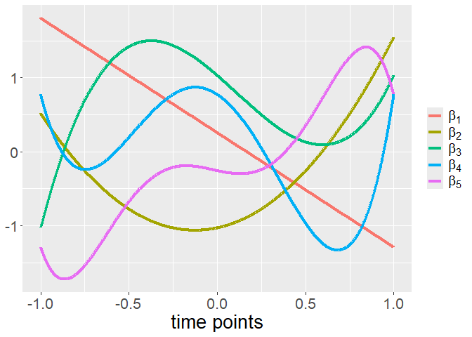
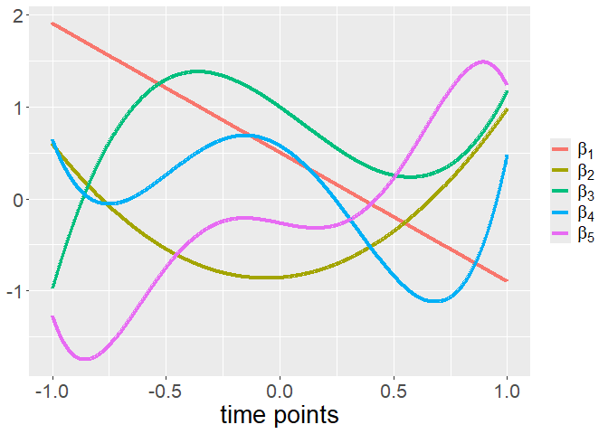

<!-- README.md is generated from README.Rmd. Please edit that file -->

# HOGLgmanova (v0.1.0)

<!-- badges: start -->

<!-- badges: end -->

This package selects explanatory variables and degrees of polynomial
basis functions in GMANOVA model by hierarchical overlapping group Lasso
(HOGL).

**cite this package of the latest version:**  
Ohishi, M. (2025). HOGLgmanova: Variable and basis function selections
in GMANOVA model. R package version 0.1.0.
<https://github.com/ohishim/HOGLgmanova>

## Installation

You can install and use `HOGLgmanova` like so:

``` r
devtools::install_github("ohishim/HOGLgmanova")
library(HOGLgmanova)
```

## Example

You can get simulation data by `genData()` and implement HOGL estimation
by `GMANOVA.HOGL()`. The simulation data is generated as

``` r
n <- 100; p <- 10; k <- 10; q <- 6
Data <- genData(n, p, k, q)
```

You can obtain true trends as

``` r
Data$trend
```



Then, HOGL estimation is implemented as

``` r
Y <- Data$Y; A <- Data$A; time.points <- Data$time.points
res <- GMANOVA.HOGL(Y, A, time.points, q)
```

Estimated trends are

``` r
res$trend
```


